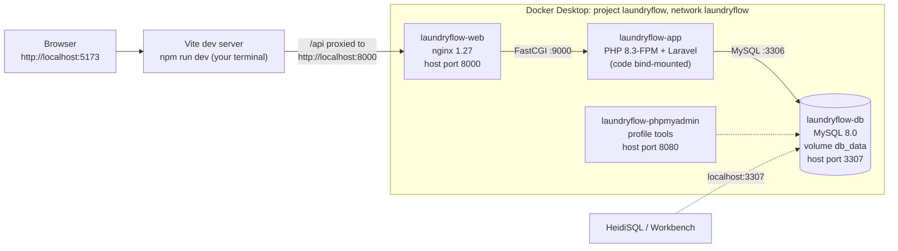

# Running LaundryFlow with Docker

The backend (Laravel API + MySQL) runs in Docker and starts on its own. Only the frontend needs a
terminal.

- **Once:** `docker compose up -d`. The backend builds, sets itself up, migrates and loads the
  demo data.
- **Every day:** start Docker Desktop (the backend comes back by itself), then `npm run dev`, and
  open <http://localhost:5173>.

Laragon still works as before. See [Docker or Laragon](#docker-or-laragon).



## Requirements

| Tool | Why | Check it (PowerShell) |
| --- | --- | --- |
| Docker Desktop for Windows, WSL2 backend | Runs the backend | `docker --version` and `docker compose version`; Docker Desktop shows "Engine running" |
| WSL2 | Docker Desktop's engine | `wsl --status` shows "Default Version: 2" |
| Node.js 20+ | The frontend only | `node --version` |
| Git | Clone the project | `git --version` |

No PHP, Composer, MySQL or Laragon is needed on the laptop.

In Docker Desktop › Settings › General, turn on **"Start Docker Desktop when you sign in to your
computer"**. Then the backend is running every time you log in to Windows.

## First run

```powershell
git clone <repository-url>
cd Final_Project_WST&AppDev        # the project root, next to compose.yaml

docker compose up -d               # or: npm run backend:up
docker compose ps                  # wait until db, app and web say "(healthy)"
```

The first `up` builds the PHP image, downloads MySQL and nginx, runs `composer install`, creates
`laravel-backend/.env` (from `.env.docker.example`) with its keys, migrates, and loads the demo
data. Follow it with `docker compose logs -f app`. Every step starts with `[laundryflow]`:

```text
[laundryflow] No .env yet: creating it from .env.docker.example
[laundryflow] Installing Composer packages (the first time takes a few minutes)...
[laundryflow] Generating APP_KEY
[laundryflow] Generating JWT_SECRET
[laundryflow] Database is ready
[laundryflow] Migrating...
[laundryflow] Empty database: seeding the demo data (about 10 seconds)...
[laundryflow] Ready: API at http://localhost:8000/api/v1 (php-fpm starting)
```

Check it: <http://localhost:8000/api/v1/health> answers
`{"data":{"status":"ok","database":"ok"},"message":"OK","status":200}`.

Then the frontend, in one terminal:

```powershell
cd react-frontend
npm install
npm run dev                        # http://localhost:5173
```

Vite prints `➜  API:     http://localhost:8000 (Docker or php artisan serve) is up`.

Sign in at <http://localhost:5173/login>. Every demo account's password is `password123`:

| Who | Sign in with | Where |
| --- | --- | --- |
| Owner (administrator) | `liza.ramos` | `/login` |
| Laundry staff | `kevin.m` | `/login` |
| Customer | `maria.santos@example.com` | `/my/login` |

## Every day

1. Start Docker Desktop, or let it start when you sign in. The backend starts by itself
   (`restart: unless-stopped`).
2. `cd react-frontend && npm run dev` (or `npm run dev` from the project root).
3. Open <http://localhost:5173>.

Double-click alternatives: `scripts\windows\start-backend.bat` and
`scripts\windows\start-frontend.bat`.

## Where things are

| What | Address |
| --- | --- |
| The app | <http://localhost:5173> |
| The API | <http://localhost:8000/api/v1> |
| Health check | <http://localhost:8000/api/v1/health> |
| API docs (Scribe) | <http://localhost:8000/docs> |
| phpMyAdmin (`npm run db:admin`) | <http://localhost:8080> |
| MySQL for HeidiSQL or Workbench | host `127.0.0.1`, port `3307`, user `laundryflow`, password `laundryflow`, database `laundryflow` |

These credentials exist only inside Docker on your laptop. Every port listens on 127.0.0.1 only,
so other devices on the Wi-Fi can't reach them.

## Commands

Run these from the project root. The `npm run` scripts don't need `npm install` at the root.

| Script | Does |
| --- | --- |
| `npm run backend:up` | `docker compose up -d --build`, then shows the status and the URLs |
| `npm run backend:down` | `docker compose --profile tools down`: stops and removes the containers (phpMyAdmin too). **The data is kept.** |
| `npm run backend:status` | `docker compose ps` |
| `npm run backend:logs` | `docker compose logs -f app web` (Ctrl+C to stop following) |
| `npm run backend:reset` | Asks for confirmation, then `php artisan migrate:fresh --seed` in the container |
| `npm run backend:test` | `composer test` in the container (the `laundryflow_test` database) |
| `npm run backend:shell` | A bash shell in the app container (`php artisan ...`, `composer ...`) |
| `npm run db:admin` | Starts phpMyAdmin (`--profile tools`) and prints its URL |
| `npm run test:contract` | Reseeds the Docker database, then runs the frontend's contract tests against it |
| `npm run dev` | The frontend dev server (`npm --prefix react-frontend run dev`) |

**Resetting the demo data:** `npm run backend:reset` (type `yes`). A normal restart never reseeds:
the demo data loads only into an empty database.

**Tests:** `npm run backend:test` (Pest, inside Docker). The frontend's own tests don't need the
backend: `cd react-frontend && npm test`.

**Stopping:** `npm run backend:down`, or quit Docker Desktop. The data stays in the `db_data`
volume.

**Removing everything, data included:**

```powershell
docker compose --profile tools down -v --rmi local
```

> **Warning:** `-v` deletes the `laundryflow_db_data` volume: every order, customer and change made
> in Docker is gone. The next `docker compose up -d` starts from fresh demo data.

## Docker or Laragon

Both can live on one laptop. They use **separate databases**: Docker's is in the `db_data` volume
(port 3307); Laragon's is in Laragon's MySQL (port 3306). Data created in one doesn't appear in
the other.

The frontend chooses the backend when `npm run dev` starts:

1. `VITE_API_PROXY_TARGET` (in `react-frontend/.env.development.local`) when it is set;
2. else `http://localhost:8000` if it answers (Docker, or `php artisan serve`);
3. else `http://laundryflow.test` if that name resolves and answers (Laragon);
4. else `http://localhost:8000`, with a hint to start Docker.

To choose one explicitly, create `react-frontend/.env.development.local`:

```ini
# Docker (the default)
VITE_API_PROXY_TARGET=http://localhost:8000
# Laragon's Apache virtual host
# VITE_API_PROXY_TARGET=http://laundryflow.test
# php artisan serve
# VITE_API_PROXY_TARGET=http://127.0.0.1:8000
```

Restart `npm run dev` after changing it. (`API_PROXY_TARGET`, the older name, still works.)

**Laragon only:** stop Docker (`npm run backend:down` or quit Docker Desktop) and follow
"Run the whole system in 5 minutes (Laragon)" in `laravel-backend/README.md`.

**How one code base serves both.** The container bind-mounts `laravel-backend/`, so it shares
`laravel-backend/.env` with Laragon. Compose passes `DB_HOST`, `DB_PORT`, `DB_DATABASE`,
`DB_USERNAME`, `DB_PASSWORD`, `APP_URL` and `FRONTEND_URL` as real environment variables. Laravel
prefers those over `.env`, so the same `.env` reaches Laragon's MySQL under Laragon and the `db`
container under Docker. `vendor/` is a Docker volume, so the container's packages never replace
Laragon's `laravel-backend/vendor`. `phpunit.xml` forces `DB_DATABASE=laundryflow_test`, so tests
never touch the demo database in either setup.

## Ports and settings

Copy `.env.example` (at the project root, next to `compose.yaml`) to `.env` to change:

| Setting | Default | Meaning |
| --- | --- | --- |
| `LAUNDRYFLOW_API_PORT` | `8000` | The API on the host. If you change it, set `VITE_API_PROXY_TARGET=http://localhost:<port>` too |
| `LAUNDRYFLOW_DB_PORT` | `3307` | MySQL on the host |
| `LAUNDRYFLOW_PMA_PORT` | `8080` | phpMyAdmin |
| `LAUNDRYFLOW_UID`, `LAUNDRYFLOW_GID` | `1000` | Who the PHP container runs as (see "Permission denied") |

Then run `docker compose up -d` again.

## Performance on Windows

The code is bind-mounted from the Windows folder, so PHP reads it through Docker Desktop's file
sharing. That is slower than Laragon, but fine for development. Two things keep it usable:
`vendor/` (most files PHP opens) is in a Docker volume, and OPcache remembers compiled files
between requests.

Measured on the demo data (Windows 11, 8 cores, project on `C:\`, Docker Desktop 4.97):

| | Docker (this setup) | `php artisan serve` | Laragon Apache |
| --- | --- | --- | --- |
| The dashboard's 8 requests at once (wall time) | about 2.2 s | 1.2 s | 0.6 s |
| One public request, warm | about 0.4 s | about 0.5 s | 0.04 s |
| `docker compose restart` until the API answers | 9 s | | |
| Docker Desktop restart until the API answers (no commands) | 54 s | | |
| `npm run backend:test` (132 tests) | about 10 min with Composer's start-up (162 s in Pest) | | |

The first build depends on the internet connection: it downloads about 1 GB (images, Debian
packages, Composer packages). On a slow connection (about 180 KB/s) it took 16.6 minutes after
the images were downloaded, plus about 10 minutes to download the PHP and Composer images.

Config and route caching would make it faster, but `bootstrap/cache` is shared with Laragon
through the bind mount, so a cached Docker config would break Laragon. The container never caches
config; it clears stale caches on every start.

Fastest: clone the project **inside WSL2** (for example `\\wsl$\Ubuntu\home\<you>\laundryflow`),
open it from there, and run the same commands. File access then stays inside Linux. This is
optional.

## Troubleshooting

**Port 8000 is already in use** ("Bind for 127.0.0.1:8000 failed"). Usually `php artisan serve` is
still running: stop it (Ctrl+C in its terminal). Find the owner with
`netstat -ano | findstr :8000`. Or move Docker's API to another port: set
`LAUNDRYFLOW_API_PORT=8001` in the root `.env`, and `VITE_API_PROXY_TARGET=http://localhost:8001`
in `react-frontend/.env.development.local`.

**Port 3307 is already in use.** Another MySQL uses it. Set `LAUNDRYFLOW_DB_PORT=3308` in the root
`.env`. Laragon's MySQL on 3306 never conflicts.

**"Cannot connect to the Docker daemon" / "Docker Desktop is not running".** Start Docker Desktop
and wait for "Engine running" in its window, then try again. `npm run backend:*` says this in plain
words.

**WSL2 is not installed.** In PowerShell as administrator: `wsl --install`, restart Windows, then
start Docker Desktop. If Docker Desktop asks for a WSL update, run `wsl --update`.

**The first build is slow.** The first `up` downloads about 1 GB of images and runs
`composer install`, which can take several minutes. Watch it with `docker compose logs -f app`.
Later starts reuse everything and take seconds.

**A logo upload says the "gd" extension is not turned on (Settings > Branding & Appearance).** The PHP image
needs the GD extension, which was added to `docker/php/Dockerfile` with the branding release. An older
image does not have it: run `npm run backend:up` (it rebuilds with `--build`) once.

**"Permission denied" on `storage/` or `bootstrap/cache`.** The container runs as a non-root user
(UID 1000). On a Windows folder, Docker Desktop maps permissions and this doesn't happen. Inside
WSL2, set `LAUNDRYFLOW_UID` and `LAUNDRYFLOW_GID` in the root `.env` to the output of `id -u` and
`id -g`, then run `npm run backend:up`. Fix existing files once with
`sudo chown -R $(id -u):$(id -g) laravel-backend/storage laravel-backend/bootstrap/cache`.

**The database is not ready yet.** On the first start, MySQL initializes for up to a minute.
`app` waits for it (compose health check, then the entrypoint for up to 120 s). If the entrypoint
gives up, check `docker compose logs db`, then `docker compose restart app`.

**An old `vendor/` after a `composer.json` change.** The entrypoint reinstalls whenever
`composer.lock` changes: run `docker compose restart app`. To start the packages from scratch:
`npm run backend:down`, `docker volume rm laundryflow_vendor`, `docker compose up -d`.

**CORS errors in the browser.** In development the browser talks only to Vite, which proxies
`/api`, so CORS isn't involved. If you call `http://localhost:8000` directly from another origin,
add that origin to `FRONTEND_URL` in `compose.yaml` (comma separated) and run
`docker compose up -d`.

**"exec /usr/local/bin/laundryflow-entrypoint: no such file or directory".** The script got Windows
line endings. `.gitattributes` keeps `*.sh` as LF and the Dockerfile strips CR anyway: run
`npm run backend:up` to rebuild. If you edited it in an editor set to CRLF, switch the file to LF.

**The frontend says "Backend not running".** Start Docker Desktop, run `docker compose up -d`,
wait for `docker compose ps` to show `(healthy)`, then restart `npm run dev`.

## What runs where (for reference)

| Service | Container | Image | Host port | Starts |
| --- | --- | --- | --- | --- |
| `db` | `laundryflow-db` | `mysql:8.0.46` | 127.0.0.1:3307 | always |
| `app` | `laundryflow-app` | built from `laravel-backend/docker/php/Dockerfile` (PHP 8.3-FPM) | none | after `db` is healthy |
| `web` | `laundryflow-web` | `nginx:1.27.5-alpine` | 127.0.0.1:8000 | after `app` is healthy |
| `phpmyadmin` | `laundryflow-phpmyadmin` | `phpmyadmin:5.2.3` | 127.0.0.1:8080 | only with `--profile tools` |

Health checks: `db` runs `mysqladmin ping`; `app` asks php-fpm for its ping page; `web` calls
`GET /api/v1/health`, which also checks the database.

There is no scheduler or queue worker: the project has no scheduled tasks and no queued jobs.
`compose.yaml` has a commented-out `scheduler` service for when one is added.

Files: `compose.yaml`, `.env.example` (root), `docker/nginx/default.conf`,
`docker/mysql/init/01-databases.sql` (runs once on an empty volume: creates `laundryflow_test`),
and `laravel-backend/docker/php/` (`Dockerfile`, `php.ini`, `www.conf`, `entrypoint.sh`).
