# LaundryFlow ERD

Generated from the final migrations in `laravel-backend/database/migrations/`, and checked column by
column and index by index against the migrated database (`information_schema`). Money is unsigned
integer centavos (`*_cents`). Timestamps are stored with the session time zone at +08:00, so
`DATE(column)` is the Manila day. Foreign keys restrict deletes on every financial and history
table, and none of those tables has a DELETE route.

```mermaid
erDiagram
    roles ||--o{ users : "has"
    roles ||--o{ role_permission : ""
    permissions ||--o{ role_permission : ""
    barangays ||--o{ customers : "lives in"
    customers ||--o| customer_accounts : "signs in with"
    customers ||--o{ orders : "places"
    users ||--o{ orders : "received_by"
    order_statuses ||--o{ orders : "current_status_id"
    orders ||--|{ order_items : "has"
    services ||--o{ order_items : "priced by"
    orders ||--|{ order_status_history : "moves through"
    order_statuses ||--o{ order_status_history : "from / to"
    users ||--o{ order_status_history : "changed_by"
    orders ||--|{ order_baskets : "held in"
    baskets ||--o{ order_baskets : "holds"
    users ||--o{ order_baskets : "assigned_by"
    users ||--o{ baskets : "created_by"
    wash_types ||--o{ orders : "wash_type_id"
    wash_types ||--o{ wash_type_supplies : "uses"
    inventory_items ||--o{ wash_type_supplies : "used by"
    orders ||--o{ inventory_movements : "soap used (usage)"
    orders ||--o{ payments : "paid by"
    payment_methods ||--o{ payments : "method"
    users ||--o{ payments : "received_by / voided_by"
    units ||--o{ inventory_items : "measured in"
    inventory_items ||--o{ inventory_movements : "moves"
    users ||--o{ inventory_movements : "recorded by"
    customers ||--o{ notifications : "customer notices"
    orders ||--o{ notifications : "about"
    users ||--o{ audit_logs : "did"

    roles {
        bigint id PK
        varchar name UK "admin | staff"
    }
    permissions {
        bigint id PK
        varchar code UK "payments.record | inventory.stock_out | payments.void"
    }
    role_permission {
        bigint role_id PK,FK
        bigint permission_id PK,FK
    }
    users {
        bigint id PK
        bigint role_id FK
        varchar name
        varchar username UK
        varchar password "bcrypt hash"
        boolean is_active
        boolean must_change_password
        timestamp last_login_at
        timestamp created_at
        timestamp updated_at
    }
    barangays {
        bigint id PK
        varchar name UK
    }
    customers {
        bigint id PK
        varchar full_name "indexed"
        char contact_number UK "09XXXXXXXXX"
        bigint barangay_id FK
        varchar street_address
        text notes
        timestamp created_at
        timestamp updated_at
    }
    customer_accounts {
        bigint id PK
        bigint customer_id FK,UK "1:1"
        varchar email UK "lower-case"
        varchar password "bcrypt hash"
        boolean is_active
        boolean must_change_password
        timestamp last_login_at
        timestamp created_at
        timestamp updated_at
    }
    services {
        bigint id PK
        varchar name
        varchar description
        enum pricing_type "per_kg | per_piece | flat"
        int rate_cents
        decimal minimum_qty "6,1"
        boolean is_active
        timestamp created_at
        timestamp updated_at
    }
    order_statuses {
        bigint id PK
        varchar code UK "received … released"
        varchar label "released = Completed"
        tinyint sort_order UK
    }
    order_sequences {
        date sequence_date PK "Manila day"
        int last_number "LF-YYMMDD-NNNN"
    }
    receipt_sequences {
        tinyint id PK "single row"
        int last_number "OR-NNNNNN"
    }
    orders {
        bigint id PK
        varchar order_number UK
        bigint customer_id FK
        bigint current_status_id FK "indexed"
        bigint received_by FK
        bigint wash_type_id FK "NOT NULL, restrict; old orders backfilled to Regular washing"
        int wash_surcharge_per_kg_cents "frozen at order time, default 0"
        timestamp received_at "indexed"
        timestamp promised_at
        timestamp released_at
        text notes
        timestamp created_at
        timestamp updated_at
    }
    order_items {
        bigint id PK
        bigint order_id FK
        bigint service_id FK
        decimal weight_kg "6,1"
        int quantity
        int unit_price_cents "frozen"
        int subtotal_cents "frozen"
    }
    order_status_history {
        bigint id PK
        bigint order_id FK
        bigint from_status_id FK
        bigint to_status_id FK
        bigint changed_by FK
        varchar note
        timestamp changed_at "index (order_id, changed_at)"
    }
    baskets {
        bigint id PK
        varchar basket_number UK "BSK-0001"
        char qr_token UK "32 chars, permanent"
        varchar label
        enum status "available | in_use | retired"
        varchar notes
        bigint created_by FK
        timestamp created_at
        timestamp updated_at
    }
    order_baskets {
        bigint id PK
        bigint order_id FK
        bigint basket_id FK
        timestamp assigned_at
        bigint assigned_by FK
        timestamp released_at
        tinyint active_flag "STORED: IF(released_at IS NULL, 1, NULL); UNIQUE(basket_id, active_flag)"
    }
    payment_methods {
        bigint id PK
        varchar code UK "cash | gcash | maya"
        varchar label
        boolean is_active "default 1: off hides it from new payments only"
        varchar display_label "nullable: the shop's own name for it"
    }
    payments {
        bigint id PK
        bigint order_id FK
        bigint payment_method_id FK
        int amount_cents
        varchar reference_number "GCash or Maya"
        varchar receipt_number UK "OR number"
        bigint received_by FK
        timestamp paid_at "index (paid_at, voided_at)"
        timestamp voided_at
        bigint voided_by FK
        varchar void_reason
    }
    units {
        bigint id PK
        varchar code UK
        varchar label
    }
    inventory_items {
        bigint id PK
        varchar name
        bigint unit_id FK
        decimal reorder_level
        boolean is_active
        timestamp created_at
        timestamp updated_at
    }
    wash_types {
        bigint id PK
        varchar name UK
        varchar description
        int surcharge_per_kg_cents "default 0 = no extra charge"
        smallint sort_order
        boolean is_active "inactive stay on old orders"
        timestamp created_at
        timestamp updated_at
    }
    wash_type_supplies {
        bigint id PK
        bigint wash_type_id FK
        bigint inventory_item_id FK
        decimal usage_per_kg_small_unit "g/kg (kg items), mL/kg (L items), pieces/kg (pcs); UNIQUE(wash_type_id, inventory_item_id)"
        timestamp created_at
        timestamp updated_at
    }
    inventory_movements {
        bigint id PK
        bigint item_id FK
        bigint user_id FK "the staff member who took the order, for usage"
        bigint order_id FK "set on usage movements"
        enum type "in | out | adjust | usage"
        decimal quantity "on hand = signed sum; usage counts as out"
        decimal required_quantity "usage: what the order needed (quantity is what was deducted)"
        varchar remarks
        timestamp moved_at
    }
    notifications {
        bigint id PK
        enum recipient_type "staff | customer"
        bigint customer_id FK
        bigint order_id FK
        varchar type
        varchar channel "in_app"
        varchar message
        varchar status "recorded"
        timestamp sent_at
        timestamp read_at
    }
    shop_settings {
        tinyint id PK "CHECK id = 1"
        varchar name
        varchar address
        varchar contact_number
        varchar opening_hours
        varchar receipt_footer
        smallint claim_policy_days
        boolean block_orders_on_low_soap "default 0 = warn and clamp, 1 = refuse with 409"
        varchar system_name "default LaundryFlow"
        varchar short_name "default LaundryFlow, at most 12 shown"
        varchar tagline "nullable"
        varchar logo_path "nullable, storage/app/public/branding"
        varchar logo_dark_path "nullable"
        varchar icon_path "nullable, square app icon"
        json icons "generated PWA icons: 192, 512, maskable, apple, favicons"
        char primary_color "default #0e7490"
        char accent_color "default #3dd6e8"
        char sidebar_color "default #0b2e3f"
        varchar contact_email "nullable"
        boolean show_contact_email "default 0"
        varchar login_message "nullable"
        varchar portal_message "nullable"
        varchar report_footer "nullable"
        json status_labels "nullable: display words only, codes never change"
        varchar basket_prefix "default BSK, new baskets only"
        varchar basket_label_footer "default Staff scan only"
        boolean basket_label_show_shop_name "default 1"
        boolean pay_at_pickup_enabled "default 1"
        boolean show_powered_by "default 0"
        json setup_checklist "nullable: the ticks of the first-login checklist"
        timestamp created_at
        timestamp updated_at
    }
    audit_logs {
        bigint id PK
        bigint user_id FK "null for customers / system"
        varchar action
        varchar auditable_type
        bigint auditable_id
        json old_values
        json new_values
        timestamp created_at
    }
```

## Indexes the lists and reports use

| Table | Index |
| --- | --- |
| `orders` | `received_at`; `current_status_id`; `(customer_id, received_at)`; `(current_status_id, promised_at)`; `(received_by, received_at)`; `order_number` unique |
| `order_items` | `(order_id, service_id)` |
| `order_status_history` | `(order_id, changed_at)`; `(order_id, to_status_id, changed_at)`; `(changed_by, changed_at)` |
| `order_baskets` | `order_id`; `UNIQUE(basket_id, active_flag)`: at most one open assignment per basket |
| `payments` | `(paid_at, voided_at)`; `(received_by, paid_at)`; `order_id` (FK); `receipt_number` unique |
| `customers` | `contact_number` unique; `full_name` |
| `inventory_movements` | `(item_id, moved_at)`; `moved_at`; `order_id` (FK) |
| `wash_types` | `name` unique |
| `wash_type_supplies` | `UNIQUE(wash_type_id, inventory_item_id)`; `inventory_item_id` (FK) |
| `orders` (wash type) | `wash_type_id` (FK) |
| `notifications` | `(recipient_type, sent_at)`; `(customer_id, read_at)` |
| `audit_logs` | `created_at`; `(auditable_type, auditable_id)`; `(user_id, created_at)` |

## Branding (migration of 2026-11-21)

`2026_11_21_000100_add_branding_to_shop_settings` only adds columns, all nullable or with a default,
so a live database keeps working untouched:

- `shop_settings`: the branding columns shown in the diagram above. The defaults are today's look
  (LaundryFlow, `#0e7490`, `#3dd6e8`, `#0b2e3f`, prefix `BSK`, every option on), so nothing changes
  until the owner edits Settings > Branding & Appearance.
- `payment_methods`: `is_active` (default on) and `display_label`. Turning a method off never alters
  an old payment: `payments.payment_method_id` still points at it and old receipts show it.
- Status labels are stored as display text only: `order_statuses.code` and every status rule are untouched.
- Image files are not in the database, only their paths; the files live in
  `storage/app/public/branding/` under content-hashed names.

## Wash types and soap usage (migrations of 2026-11-20)

All additive, safe on a live database with `php artisan migrate --force`:

1. `create_wash_types`: the two new tables; inserts the five wash types (by name) and, on an existing
   install, the Maya payment method and the units L, kg and pcs (by code). Never touches a row that
   exists.
2. `add_wash_type_to_orders`: `orders.wash_type_id` (added nullable, every existing order set to
   "Regular washing" with `wash_surcharge_per_kg_cents = 0`, then made NOT NULL) and
   `wash_surcharge_per_kg_cents`.
3. `add_soap_usage_to_inventory`: `inventory_movements.order_id` and `required_quantity`, the `usage`
   value appended to the type enum, and `shop_settings.block_orders_on_low_soap` (default off).

No total is stored. An order's total is `SUM(order_items.subtotal_cents) +
ROUND(SUM(order_items.weight_kg) * orders.wash_surcharge_per_kg_cents)`: only per-kg lines carry a
weight, so the surcharge applies to the per-kg weight. The charge is a column of the order rather
than an order line because `order_items.service_id` is required and a wash type is not a service;
the reports show it as its own category, "Wash type surcharges".

Not created, as the enhancement removed them: `orders.qr_token` and the public tracking columns.
`personal_access_tokens` exists because `php artisan install:api` (course L3) creates it. It stays
empty: authentication is JWT.
