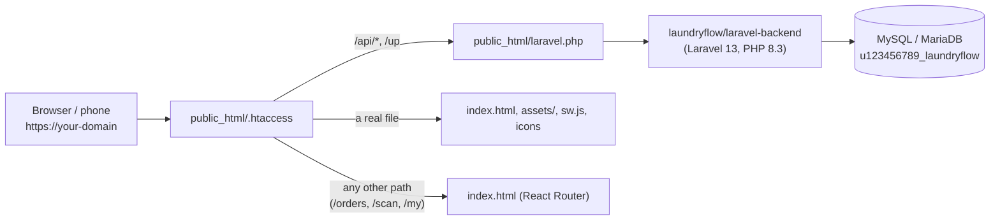

# Deploying LaundryFlow on Hostinger

One domain serves both apps. The React app sits in `public_html`; the Laravel API sits **outside**
it, so `.env`, `vendor/` and the logs can never be downloaded. A small front controller
(`laravel.php`) hands every `/api/...` request to Laravel. Browser and API share one origin, so
there is no CORS to configure.



On the server:

```text
/home/u123456789/domains/your-domain/
├── public_html/                  <- npm run build:hostinger (React build + .htaccess + laravel.php)
└── laundryflow/                  <- git clone of this repository
    └── laravel-backend/          <- the API: .env, vendor/, storage/ live here
```

The templates are in [`hostinger/public_html/`](hostinger/public_html/), the server's `.env` in
[`../laravel-backend/.env.hostinger.example`](../laravel-backend/.env.hostinger.example).

## What you need

- A Hostinger plan with **SSH access** (Premium, Business or Cloud web hosting) and a domain
  pointed at it. On a plan without SSH, see [No SSH](#no-ssh).
- This repository on GitHub, with everything to deploy pushed to `main`.
- On your PC: Node.js 20+ and `npm install` done once in `react-frontend/`.

`u123456789` and `your-domain` below are placeholders: use your own account name (hPanel shows it
under **Advanced > SSH Access**, "Username") and domain.

## 1. Set PHP to 8.3 or newer

hPanel > **Websites > your domain > Advanced > PHP Configuration**: choose **PHP 8.3** (or 8.4).
Laravel 13 refuses older versions. On the **PHP extensions** tab keep these on (they are by
default): `pdo_mysql`, `mbstring`, `openssl`, `fileinfo`, `sodium`, `tokenizer`, `ctype`, `dom`,
`xml`, `curl`.

## 2. Create the database

hPanel > **Databases > MySQL Databases** > *Create a new MySQL database and database user*:

- Database name: `laundryflow` (Hostinger saves it as `u123456789_laundryflow`)
- Username: `laundryflow` (saved as `u123456789_laundryflow`)
- A strong password. Keep it for step 5.

Hostinger's databases are MariaDB; the migrations and the test suite were run against
MariaDB 11.8 before release.

## 3. Turn on SSH and connect

hPanel > **Advanced > SSH Access** > Enable. It shows the IP, port (65002) and username. From
PowerShell:

```powershell
ssh -p 65002 u123456789@<the IP shown>
```

Then check the tools (PHP must say 8.3 or newer; if not, re-check step 1):

```bash
php -v
composer --version
git --version
```

## 4. Get the code onto the server

```bash
cd ~/domains/your-domain
git clone https://github.com/<owner>/<repo>.git laundryflow
```

**Private repository?** Give the server a read-only deploy key first:

```bash
ssh-keygen -t ed25519 -C "hostinger" -f ~/.ssh/id_ed25519 -N ""
cat ~/.ssh/id_ed25519.pub
```

On GitHub: repository > **Settings > Deploy keys > Add deploy key**, paste it, leave "Allow
write access" off. Then clone with the SSH address instead:
`git clone git@github.com:<owner>/<repo>.git laundryflow`.

## 5. Install and configure the API

```bash
cd ~/domains/your-domain/laundryflow/laravel-backend
composer install --no-dev --optimize-autoloader --no-interaction
cp .env.hostinger.example .env
nano .env
```

In `.env`, replace every `<...>`:

| Key | Value |
| --- | --- |
| `APP_URL` | `https://your-domain` (no trailing slash) |
| `FRONTEND_URL` | the same `https://your-domain` |
| `DB_DATABASE` / `DB_USERNAME` | `u123456789_laundryflow` from step 2 |
| `DB_PASSWORD` | the password from step 2 |
| `MAIL_FROM_ADDRESS` | `no-reply@your-domain` |

Keep `APP_ENV=production` and `APP_DEBUG=false`. Leave `APP_KEY` and `JWT_SECRET` empty: the next
commands fill them. Save with Ctrl+O, Enter, Ctrl+X. Then:

```bash
php artisan key:generate --force
php artisan jwt:secret --force
php artisan migrate --force
```

Load the data, **one** of:

```bash
php artisan db:seed --force                                  # demo shop: 120 days of orders (presentations)
php artisan db:seed --class=ReferenceDataSeeder --force      # empty shop: settings, statuses, staff accounts only
```

Then cache the configuration and lock down `.env`:

```bash
php artisan optimize
chmod 600 .env
```

Every seeded account's password is `password123`. Change them right after the first sign-in
(step 9). Run `php artisan optimize` again after **every** later change to `.env`.

## 6. Build the frontend (on your PC)

In the project root:

```powershell
npm run build:hostinger
```

It type-checks, builds the React app for the real API (`react-frontend/.env.production`), adds
`.htaccess` and `laravel.php`, and writes:

- `build/hostinger/public_html/` (the folder)
- `build/hostinger/public_html.zip` (the same, zipped)

## 7. Upload it to public_html

hPanel > **Websites > your domain > Files > File Manager** > open `public_html`:

1. Delete what Hostinger put there (`default.php`, any `index.html`).
2. **Upload** `build/hostinger/public_html.zip`, right-click it > **Extract** into `public_html`
   itself (not a subfolder), then delete the zip.
3. Check that `.htaccess` and `laravel.php` sit directly in `public_html`, next to `index.html`.
   (Hidden files: File Manager settings > "Show hidden files".)

Over SSH instead, from PowerShell on your PC:
`scp -P 65002 build/hostinger/public_html.zip u123456789@<IP>:domains/your-domain/public_html/`,
then on the server `cd ~/domains/your-domain/public_html && unzip -o public_html.zip && rm public_html.zip`.

If you cloned somewhere else than `~/domains/your-domain/laundryflow`, edit the `$backend` line
in `public_html/laravel.php` to point at `laravel-backend`.

## 8. HTTPS

hPanel > **Security > SSL**: install the free SSL certificate for the domain (often already
active), and turn on **Force HTTPS**. The `.htaccess` redirects to HTTPS too. Phones need HTTPS for
the QR scanner camera and to install the app.

## 9. Check it

| Open | Expect |
| --- | --- |
| `https://your-domain/up` | a green "Application up" page |
| `https://your-domain/api/v1/health` | JSON with `"status":"ok","database":"ok"` |
| `https://your-domain/` | the LaundryFlow sign-in screen |
| `https://your-domain/orders`, then refresh (F5) | the same app, not a 404 |

Sign in as the owner `liza.ramos` / `password123` and change the password (sidebar > password
link, `https://your-domain/password`). Do the same for `kevin.m` and `aira.d`, or disable them
under **Settings > Users**. Demo customer
accounts (e.g. `maria.santos@example.com`) also use `password123`.

## Updating the live site

Backend (on the server):

```bash
cd ~/domains/your-domain/laundryflow
git pull
cd laravel-backend
php artisan down
composer install --no-dev --optimize-autoloader --no-interaction
php artisan migrate --force
php artisan optimize
php artisan up
```

Frontend (on your PC): `npm run build:hostinger`, then repeat step 7 (delete the old `assets/`
folder first). Open users get an "update available" prompt from the service worker.

Never run `php artisan migrate:fresh` or `db:seed` on the live site after day one: both erase or
duplicate real data.

## Hostinger CDN or Cloudflare

If the domain goes through Hostinger CDN or Cloudflare, set `TRUSTED_PROXIES=*` in `.env` and run
`php artisan optimize`. Otherwise every visitor seems to come from the CDN's address and they all
share one sign-in and registration rate limit.

## No SSH

On a plan without SSH, prepare the API on your PC and upload it:

1. Copy `laravel-backend/` to a new folder outside the project, and in that copy run
   `composer install --no-dev --optimize-autoloader`.
2. In that copy, `copy .env.hostinger.example .env`, fill it in as in step 5 (the host is the
   server's database host), and generate the two secrets locally:
   `php artisan key:generate --force` and `php artisan jwt:secret --force`.
3. Zip the copy, upload it to `domains/your-domain/`, and extract it so that the path is
   `domains/your-domain/laundryflow/laravel-backend/`.
4. Create the tables with hPanel > Databases > **phpMyAdmin** > Import, from a dump of a local
   database that was migrated and seeded (`mysqldump laundryflow > laundryflow.sql`).
5. Continue with step 6. Skip `php artisan optimize` (it needs a shell); the app runs uncached.

## Troubleshooting

| Symptom | Cause and fix |
| --- | --- |
| `{"message":"The API is not installed yet."}` | `laravel.php` cannot find `laravel-backend/vendor`. Check the `$backend` path and that `composer install` ran. |
| `500 Server error` from every API call | Read `laravel-backend/storage/logs/laravel-<date>.log`. Usually `.env` (database name, prefix, password); after fixing, `php artisan optimize`. |
| `SQLSTATE[HY000] [1045] Access denied` | The database user or password; both names carry the `u123456789_` prefix. |
| Sign-in works, then every screen says you are signed out | The `Authorization` header is lost: `public_html/.htaccess` is missing or not the one from the build. |
| 404 when refreshing a page such as `/orders` | `.htaccess` is missing from `public_html` (hidden files were not uploaded). |
| Changes to `.env` do nothing | The configuration is cached: `php artisan optimize`. |
| Old screens after an update | The service worker: reload once, or accept the "update available" prompt. |
| Camera / QR scanner does not open | The site is on `http://`: finish step 8. |
