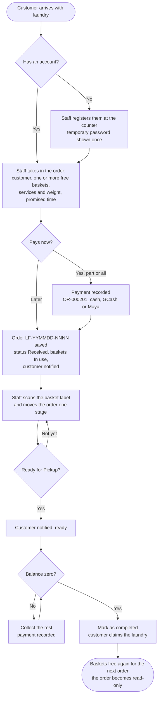
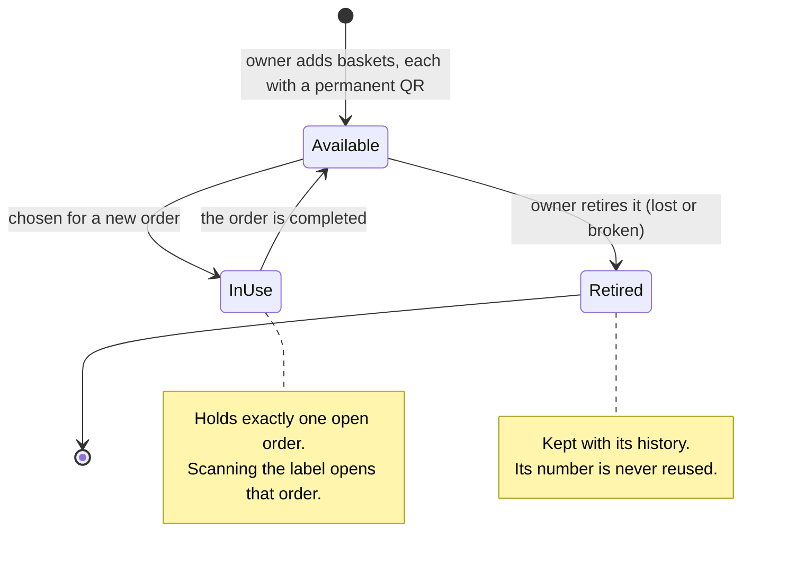
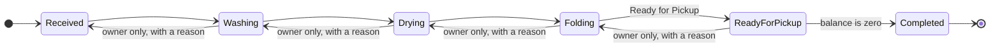

# LaundryFlow: system overview

LaundryFlow runs a laundry shop in Bongabong, Oriental Mindoro: taking in laundry at the counter,
tracking every load by the QR label on its basket, collecting payments, and letting each customer
follow their own laundry from their phone. It has two parts:

- **`laravel-backend/`**: the REST API (Laravel 13, MySQL, JWT), versioned at `/api/v1`.
- **`react-frontend/`**: one web app (React, installable as a PWA) with two sides, the staff app
  (`/`) and the customer portal (`/my`).

Setup: [`laravel-backend/README.md`](../laravel-backend/README.md), "Run the whole system in 5
minutes". Every endpoint: [`API_INVENTORY.md`](API_INVENTORY.md). The tables:
[`ERD.md`](ERD.md). The course conventions: [`COURSE_CONVENTIONS.md`](COURSE_CONVENTIONS.md).

## The three roles

| | Owner (admin) | Staff | Customer |
| --- | --- | --- | --- |
| Signs in at | `/login` with a username | `/login` with a username | `/my/login` with an email |
| Account made by | the seed (one owner) | the owner, in Settings › Users & roles | themselves (`/register`) or the counter |
| Dashboard | Sales, money and work charts, every date range, comparison with the previous period | Work charts only: no peso amount anywhere, in the screen or in the API answer | Their laundry in progress and its stage |
| Customers | Register, edit, create an account for a legacy profile, reset a password, **disable** sign-in | Register, edit, create an account, reset a password | Edit their own phone, barangay and street |
| Orders | Everything staff can, plus **move an order back** one stage (with a reason) | Take in orders, scan baskets, move orders **forward** one stage | See their own orders and order summaries |
| Payments | Record, **void** (with a reason), see the payment log and balances | Record payments and see them, **if the owner allows it** | See their payments on the order summary |
| Baskets | **Add, print, edit, retire** | Scan, choose a free basket for an order | — |
| Inventory | Supply items, stock in and adjustments | See stock; record stock-out **if allowed** | — |
| Reports, settings | **Reports** (7, with export and print), services and rates, users, staff permissions, shop profile, activity log | — | — |
| Password | Change it; reset other staff's | Change it; must change a temporary one | Change it; must change a temporary one |

Staff abilities are fixed except three switches the owner controls for all staff at once (Settings
› Users & roles › Staff permissions): **Record payments**, **Record stock-out of supplies** and
**Void or edit a saved payment**. Switching one off takes effect on the very next request.

## The laundry transaction flow

The customer follows all of it at `/my`: the dashboard refreshes every 15 seconds, and each stage
change sends them a notification. Their order summary replaces a printed receipt.

## The basket QR lifecycle

- The label carries the URL `/b/<token>`. A staff phone that opens it sees the basket's current
  order; anyone else sees a neutral notice and nothing about the laundry.
- A basket in use cannot be retired, and cannot go on a second order: the API refuses with
  **409 "BSK-0007 is in use by LF-261110-0003."**, decided under a database lock (two counters
  choosing the same basket at the same moment get one 201 and one 409, tested with 10 at once).
- Reprinting a label prints the same QR, so an old label keeps working.

## The status flow

- Forward one stage at a time; skipping answers **409 "Orders move one stage at a time. Next is
  Washing."**
- Back one stage only for the owner, with a reason saved in the history.
- **Completed** needs a zero balance (**409 "Settle the balance before completing this order."**),
  frees the baskets, and locks the order: no more edits, moves, payments or voids (**409 "This
  transaction is completed."**).
- A scan sends the basket along, so a stale screen whose basket no longer holds the order gets
  **409 "This basket has no active laundry session."**
- Every move is written to the status history, the activity log and the customer's notifications.

## Wash types and soap usage

A **wash type** says how the customer's laundry is washed: Regular washing, Colored clothes,
Softness and fragrance, Stain removal and Tough stains (the owner can add, rename, reorder and
deactivate them). It is not a service: an order still has its services and load, plus exactly one wash
type (Regular washing unless chosen). It applies to the order's **per-kg weight**, the total kilos of
its per-kg service lines; an order with only comforters or ironing has no surcharge and uses no soap.

- **Charge.** Each wash type has an optional surcharge per kilo (₱0 by default). The charge is
  surcharge per kg × per-kg weight, in centavos, shown as its own bill line ("Wash type: Tough stains —
  ₱5.00/kg × 6.5 kg = ₱32.50", or "— no extra charge"). The surcharge is frozen on the order
  (`orders.wash_surcharge_per_kg_cents`), exactly like a service's `unit_price_cents`, so changing it later
  never changes an old order.
- **Soap.** The owner assigns inventory items to each wash type with an amount per kilo in the item's
  small unit: grams for kg items, millilitres for L items, pieces for pcs items
  (`usage_per_kg_small_unit`). The amount an order uses is that × the per-kg weight, converted to the
  item's unit (g ÷ 1000 → kg, mL ÷ 1000 → L). kg and L keep three decimals (1 g or 1 mL); pcs round **up**
  per order and per item.
- **Deduction.** In the same transaction that creates the order, each assigned item gets an inventory
  movement of type `usage`, linked to the order and made by the staff member who took it in ("Order
  LF-… · Tough stains · 6.5 kg"). Stock stays computed from movements. Orders cannot be edited
  (only their notes and estimated completion), so there are no usage adjustments; movements are never
  edited or deleted.
- **Not enough stock.** Off (default): the New Order form warns ("Fabric conditioner: needs 130 mL, only
  80 mL recorded"), staff can still save, only what is recorded is deducted (never below zero), the
  shortfall goes into the movement's remarks and the staff bell says "Record a stock-in for …". On
  (Settings > Pricing & Usage > Stock rule): the API answers 409 with the same message and nothing is saved.
- **Who sees what.** Staff see the soap preview on New Order, the soap on the order page and, most
  prominently, on the QR scan result ("Use: Detergent pods 2 pcs, Stain remover 163 mL"). Customers see the
  wash type name and its charge, never soap quantities.

**Worked example: 6.5 kg of Wash-Dry-Fold as Tough stains** (₱5/kg; Detergent pods 0.25 pcs/kg; Stain
remover 25 mL/kg):

| | Calculation | Result |
| --- | --- | --- |
| Wash-Dry-Fold | 6.5 kg × ₱35 | ₱227.50 |
| Wash type surcharge | 6.5 kg × ₱5.00 | ₱32.50 |
| **Total** | | **₱260.00** |
| Detergent pods | 0.25 × 6.5 = 1.625 pcs, rounded up | **2 pcs** |
| Stain remover | 25 mL × 6.5 = 162.5 mL, kept at 1 mL precision | **163 mL** (0.163 L) |

The rules live in one place on each side (`laravel-backend/app/Support/WashRules.php` and
`react-frontend/src/lib/wash.ts`) and both are tested with the same cases in `shared/wash-cases.json`.

## Business rules

**Orders and money**

- Money is integer centavos everywhere (`*_cents`). Totals, balances and stock on hand are
  computed, never stored.
- Prices are frozen into the order when it is taken in: changing a service's rate later never
  changes an old order.
- Per-kilogram services charge at least their minimum (Wash-Dry-Fold: 3 kg), in steps of 0.1 kg.
  Per-piece services need a whole quantity. A flat service (Express) applies once per order.
- An order needs a customer **with an account** (the account is where they see it), at least one
  basket and at least one service.
- Order numbers are `LF-YYMMDD-NNNN`, numbered per Manila day with no gaps: a refused order never
  uses up a number, even when 20 counters save at once.
- A payment is more than zero and at most the balance. Receipt numbers `OR-000201…` are
  sequential. A void needs a reason and the void permission, and re-opens the balance; the voided
  payment stays in the history.

**Accounts and security**

- Passwords: at least 8 characters, with a letter and a number, different from the current one.
- A temporary password (from the counter or an owner's reset) is shown once; only its hash is
  stored. Until the person picks their own, every page but the change-password page is closed to
  them (Sign out still works).
- Five failed sign-ins a minute for one name and address are refused with 429. Registration (10 a
  minute per address) and scanning (120 a minute per staff member) are limited too.
- Disabling an account, staff or customer, signs it out everywhere at once. Nothing financial is
  ever deleted: users are disabled, baskets retired, payments voided.
- A customer sees only their own orders and notifications; another customer's order number
  answers "not found", exactly like a number that does not exist.

**Inventory**

- A supply item is **Low** at or below its reorder level and **Critical** at or below half of it;
  dropping into either sends the staff a notice (the bell in the staff app).
- A stock-out can never exceed what is on hand; an adjustment needs a remark and cannot go below
  zero.

**Reports**

- Every date is a Manila day (`Asia/Manila`, the database session at +08:00). The dashboard, the
  sales report, the payments report and the payment log agree to the centavo (tested).

## Tech stack

| Layer | What | Version |
| --- | --- | --- |
| API | Laravel, PHP | 13.40, PHP 8.3 |
| Database | MySQL (Laragon) | 8.4 |
| Authentication | JWT, `php-open-source-saver/jwt-auth`: two guards (staff, customer), abilities in the token | 2.10 |
| API docs | Scribe: `/docs`, Postman collection, OpenAPI | 5.11 |
| Backend tests | Pest (feature, unit, a real concurrency test), Laravel Pint | 4.7 |
| Frontend | React, TypeScript, React Router | 18.3, 5.9, 6.30 |
| Data and forms | TanStack Query, Zustand, React Hook Form, Zod, Axios | 5, 5, 7, 4, 1 |
| UI | Tailwind CSS, Radix UI, Recharts (charts), lucide icons | 4.3 |
| QR | `qrcode.react` (labels), `@yudiel/react-qr-scanner` (camera) | 4.2, 2.6 |
| Build, PWA | Vite, `vite-plugin-pwa` (Workbox: app shell offline, never `/api/`) | 8.3, 2.0 |
| Frontend tests | Vitest, Playwright (Chrome), MSW (the mock API for the demo build and unit tests) | 5.0, 1.65, 2.15 |
| Local server | Laragon: Apache with PHP as a module (parallel requests), OPcache | — |

## How the course conventions were applied

The backend follows the course **"API Master Class in Laravel"** item by item;
[`COURSE_CONVENTIONS.md`](COURSE_CONVENTIONS.md) lists each convention with its lesson and the 20
places where the course and the app's needs had to be reconciled. In short:

- **Versioning and routes (L7, L8):** every route in `routes/api_v1.php` under `/api/v1`, a
  public `auth` group, then guarded groups; resource routes with PUT for replace and PATCH for
  update (L17, L18).
- **Controllers (L9–L20):** thin `Api/V1` controllers extending `APIController`; every action,
  reads included, checks a policy with `isAble()`; no try/catch.
- **Form Requests (L15, L18):** a `Base…Request` with `mappedAttributes()` and Store / Replace /
  Update requests; custom messages; `bodyParameters()` for Scribe.
- **Resources (L9–L11):** JSON:API style (`type`, `id`, `attributes`, `relationships`, `includes`,
  `links`), camelCase names, `?include=` loaded only when asked for, paginated lists with `links`
  and `meta`.
- **Errors (L25):** one handler and one format, `{ errors: [{ status, message, source }] }`: 401,
  403, 404, 405, 409, 422, 429 and 500, with file and line only for a crash while debugging.
- **Authentication (L8, L20):** JWT with `formatToken()`, refresh and logout blacklisting;
  abilities written into the token and read by `tokenCan()`, re-checked against the database so a
  revoked permission stops at once.
- **Filters and sorting (L12, L14):** a `QueryFilter` per list, comma lists and ranges
  (`receivedAt=2026-11-01,2026-11-08`), `*` wildcards, a `sort` whitelist.
- **Documentation (L26):** Scribe groups, titles, query and body parameters, `/docs`, the Postman
  collection and the OpenAPI file, committed.
- **Beyond the course,** where the app needed it and the course is silent: transactional actions
  (`app/Actions/V1`) with row locks, Pest tests for every module and rule, a query-count test per
  list, a real concurrency test, and the React frontend, whose single adapter
  (`src/lib/apiAdapter.ts`) speaks the course's shapes so no screen had to change.
